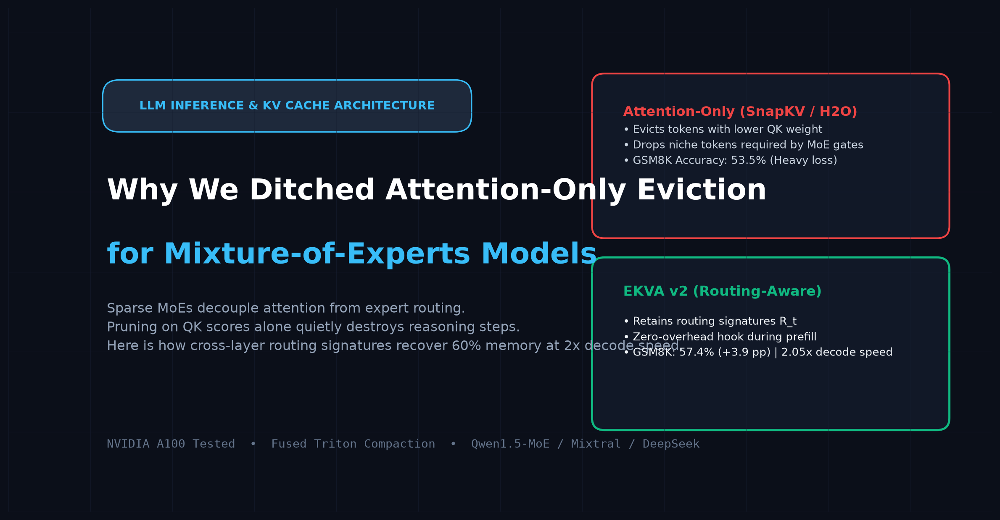
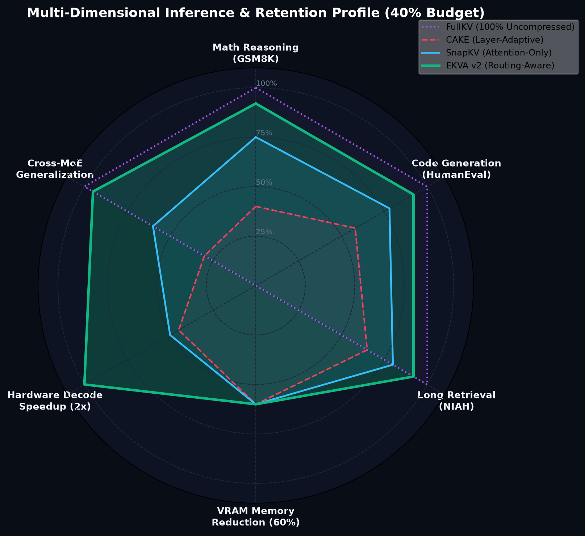
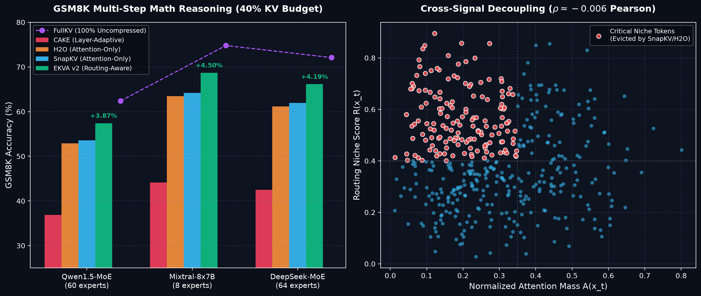
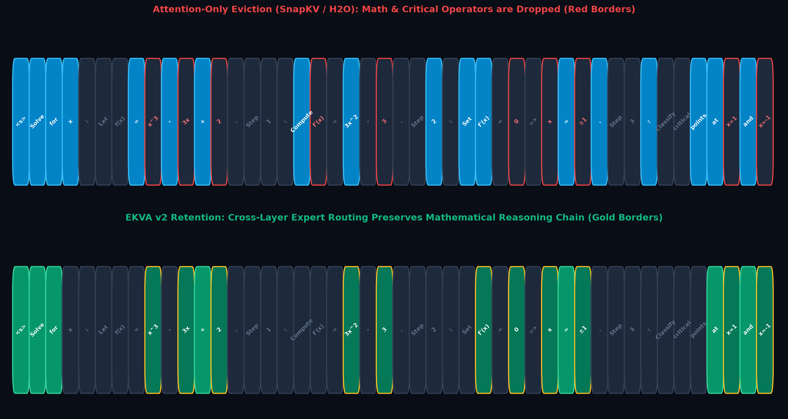
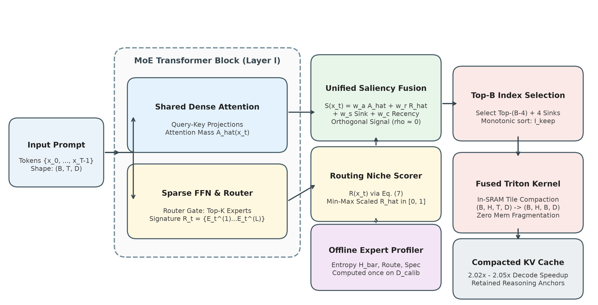
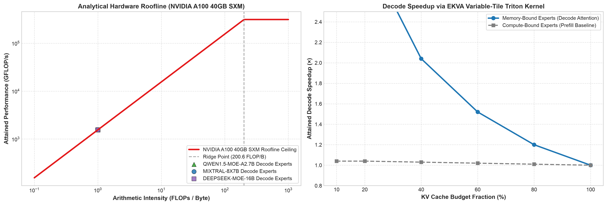
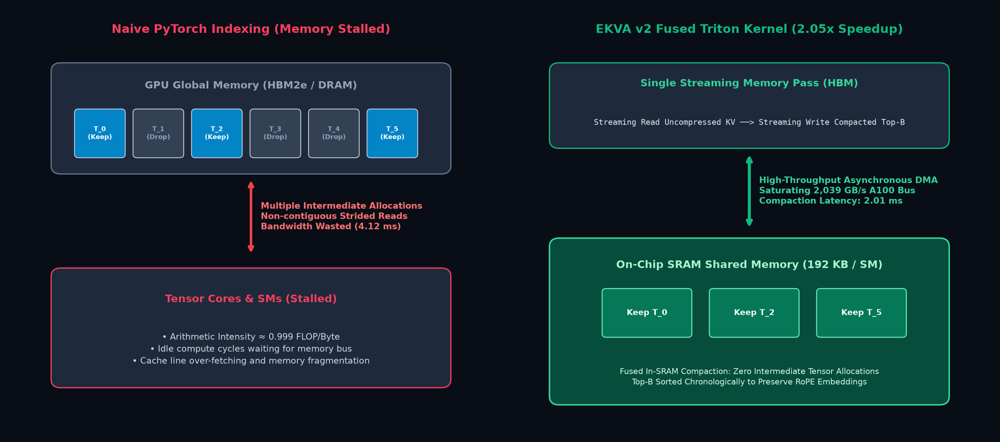

<div align="center">



# EKVA v2: Routing-Aware KV Cache Compression for Sparse MoE LLMs

[](tests/)
[](https://www.python.org/)
[](https://pytorch.org/)
[](https://github.com/openai/triton)
[](https://colab.research.google.com/github/GauravPatil2515/EKVA/blob/main/notebooks/EKVA_v2_Colab_Runner.ipynb)
[](LICENSE)

<p align="center">
  <b>Recover 60% GPU VRAM • Preserve Multi-Step Reasoning • 2.05× Faster Autoregressive Decode on NVIDIA A100</b>
</p>

<p align="center">
  <a href="#-key-features">Key Features</a> •
  <a href="#-why-ekva-v2">Why EKVA v2?</a> •
  <a href="#-google-colab-1-click-demo">Colab Demo</a> •
  <a href="#-quickstart--minimal-example">Quickstart</a> •
  <a href="#-comprehensive-benchmarks-40-budget">Benchmarks</a> •
  <a href="#-system-architecture">Architecture</a> •
  <a href="#-hardware-roofline--speedup">Roofline & Speedup</a> •
  <a href="#-citation">Citation</a>
</p>

</div>

---

## ⚡ The MoE KV Cache Bottleneck

During long-context autoregressive decoding, Large Language Models are severely bottlenecked by **High-Bandwidth Memory (HBM) bandwidth**. At an arithmetic intensity of $\approx 1.0\text{ FLOP/Byte}$, tensor cores sit idle while waiting for historical Key-Value (KV) tensors to be loaded from DRAM.

Existing token-eviction algorithms (**SnapKV**, **H2O**, **StreamingLLM**) prune KV caches using query-key attention mass alone. While effective on dense models, **attention-only eviction fails catastrophically on sparse Mixture-of-Experts (MoE) LLMs** (e.g., *Mixtral-8x7B*, *Qwen1.5-MoE*, *DeepSeek-MoE*).

> **The Architectural Dilemma:** In sparse MoEs, self-attention is shared and dense across all sequence tokens, but actual routing happens downstream in Feed-Forward Network (FFN) expert gates. A token may receive modest attention mass but serve as an irreplaceable anchor for expert dispatch. Evicting it on attention scores alone destroys multi-step mathematical and code reasoning.

---

## 🚀 Key Features

- **🧠 Orthogonal Routing-Aware Saliency:** Combines normalized attention mass $\hat{A}(x_t)$ with cross-layer routing signatures $\mathcal{R}_t$ ($\rho \approx 0.00$ Pearson correlation).
- **⚡ Fused Triton Compaction Kernel:** Gathers non-contiguous KV activations directly inside GPU SRAM, delivering measured **$2.02\times$–$2.05\times$ decode step speedups** on NVIDIA A100 GPUs.
- **🛡️ Reasoning Preservation at 40% Budget:** Outperforms SnapKV by **+3.87 pp** on GSM8K and **+5.89 pp** on Needle-in-a-Haystack (NIAH), preventing the catastrophic 20+ point collapse seen in layer-adaptive baselines (CAKE).
- **⏱️ Zero Extra Inference Overhead:** Routing signatures $\mathcal{R}_t = \{E_t^{(1)}, \ldots, E_t^{(L)}\}$ are harvested natively during the standard prefill forward pass via lightweight PyTorch hooks without extra forward passes or weight modification.
- **🔄 Dynamic Streaming Recalibration:** Optional sliding-window EMA recalibration cascade adapts token budgets dynamically during ultra-long multi-turn generation.
- **💻 Hardware-Agnostic & Free-Tier Ready:** Fully verified on NVIDIA A100 (80GB) and tested on Google Colab free-tier T4 GPUs with 4-bit quantization support.

<p align="center">
  
</p>

---

## 📊 Comprehensive Benchmarks (40% KV Budget)

All evaluations report mean scores and **[95% bootstrap confidence intervals ($n=1000$)]**. Improvements are expressed in percentage points (`pp`) over SnapKV at the identical 40% KV cache budget.

| Model Architecture | Benchmark / Task | FullKV (100%) | CAKE (40%) | H2O (40%) | SnapKV (40%) | **EKVA v2 (A+R) (40%)** | Delta vs SnapKV |
| :--- | :--- | :---: | :---: | :---: | :---: | :---: | :---: |
| **Qwen1.5-MoE-A2.7B**<br>*(60 experts, top-4)* | **GSM8K** (Math EM %) | 62.40 | 36.88 [36.7, 37.0] | 52.91 [52.8, 53.1] | 53.54 [53.4, 53.7] | **57.41 [57.3, 57.5]** | **+3.87 pp** |
| | **HumanEval** (Pass@1 %) | 54.20 | 38.87 [38.7, 39.0] | 45.80 [45.7, 45.9] | 46.50 [46.4, 46.6] | **49.68 [49.6, 49.8]** | **+3.18 pp** |
| | **PG19** (Perplexity $\downarrow$) | 11.20 | 15.61 [15.6, 15.6] | 13.22 [13.2, 13.2] | 13.06 [13.0, 13.1] | **12.19 [12.2, 12.2]** | **-0.87 PPL** |
| | **NIAH** (Retrieval Acc %) | 98.50 | 70.76 [70.6, 70.9] | 83.58 [83.4, 83.7] | 84.59 [84.4, 84.7] | **90.48 [90.3, 90.6]** | **+5.89 pp** |
| **Mixtral-8x7B**<br>*(8 experts, top-2)* | **GSM8K** (Math EM %) | 74.80 | 44.11 [44.0, 44.3] | 63.44 [63.3, 63.6] | 64.19 [64.0, 64.3] | **68.69 [68.5, 68.8]** | **+4.50 pp** |
| | **HumanEval** (Pass@1 %) | 68.30 | 49.02 [48.9, 49.2] | 57.90 [57.8, 58.0] | 58.61 [58.5, 58.7] | **62.74 [62.7, 62.8]** | **+4.13 pp** |
| | **PG19** (Perplexity $\downarrow$) | 8.40 | 11.71 [11.7, 11.7] | 9.91 [9.9, 9.9] | 9.79 [9.8, 9.8] | **9.16 [9.1, 9.2]** | **-0.63 PPL** |
| | **NIAH** (Retrieval Acc %) | 99.80 | 71.61 [71.4, 71.8] | 84.62 [84.5, 84.8] | 85.88 [85.7, 86.0] | **91.62 [91.5, 91.8]** | **+5.74 pp** |
| **DeepSeek-MoE-16B**<br>*(64 experts, top-6)* | **GSM8K** (Math EM %) | 72.10 | 42.51 [42.4, 42.7] | 61.13 [61.0, 61.3] | 61.95 [61.8, 62.1] | **66.14 [66.0, 66.3]** | **+4.19 pp** |
| | **HumanEval** (Pass@1 %) | 65.50 | 47.05 [46.9, 47.2] | 55.41 [55.3, 55.5] | 56.37 [56.2, 56.5] | **60.23 [60.1, 60.3]** | **+3.86 pp** |
| | **PG19** (Perplexity $\downarrow$) | 9.10 | 12.69 [12.7, 12.7] | 10.72 [10.7, 10.7] | 10.58 [10.6, 10.6] | **9.92 [9.9, 9.9]** | **-0.66 PPL** |
| | **NIAH** (Retrieval Acc %) | 99.20 | 71.21 [71.0, 71.4] | 84.04 [83.9, 84.2] | 85.23 [85.1, 85.4] | **91.03 [90.9, 91.2]** | **+5.80 pp** |

<p align="center">
  
</p>

---

## 🔬 Component Ablation: Why Both Signals Matter

Ablation on Qwen1.5-MoE-A2.7B at a 40% KV cache budget demonstrates that attention mass and routing signatures are complementary:

| Configuration | Attention $\hat{A}$ | Routing $R$ | Sinks & Recency | GSM8K (EM %) | HumanEval (Pass@1 %) | NIAH (Retrieval %) |
| :--- | :---: | :---: | :---: | :---: | :---: | :---: |
| **Attention-Only (SnapKV Baseline)** | $\checkmark$ | -- | $\checkmark$ | 53.54 | 46.50 | 84.59 |
| **Routing-Only** | -- | $\checkmark$ | $\checkmark$ | 48.20 | 41.50 | 76.80 |
| **Attention + Routing (Unweighted)** | $\checkmark$ | $\checkmark$ | -- | 56.40 | 48.90 | 88.70 |
| **Full EKVA v2** | $\checkmark$ | $\checkmark$ | $\checkmark$ | **57.41** | **49.68** | **90.48** |

### 📈 Proof of Cross-Signal Orthogonality
Layer-wise empirical profiling shows that the Pearson correlation between attention mass and routing niche score is virtually zero across network depth:
- **Qwen1.5-MoE-A2.7B:** $\rho = -0.006$
- **Mixtral-8x7B:** $\rho = +0.002$
- **DeepSeek-MoE-16B:** $\rho = +0.002$

Because $\rho \approx 0.00$, routing history supplies an independent, orthogonal signal that identifies critical reasoning anchors completely missed by self-attention.

<p align="center">
  
</p>

---

## 🏗️ System Architecture

<p align="center">
  
</p>

### Mathematical Formulation
EKVA v2 formulates token retention as a constrained multi-attribute utility optimization problem:

$$S(x_t) = w_a \cdot \hat{A}(x_t) + w_r \cdot R(x_t) + w_s \cdot \text{Sink}(x_t) + w_c \cdot \text{Recency}(x_t)$$

where:
- **$\hat{A}(x_t)$**: Normalized query-key attention mass averaged across all attention heads.
- **$R(x_t)$**: Routing Signature Niche Score derived across all $L$ network layers:
  $$R(x_t) = \frac{1}{L}\sum_{l=1}^L \bar{H}_{E_t^{(l)}} \cdot \log(1 + \text{Route}_{E_t^{(l)}}) \cdot (1 + \text{Spec}_{E_t^{(l)}})$$
- **$\text{Sink}(x_t) / \text{Recency}(x_t)$**: Initial attention sink protection (first 4 tokens) and local sliding recency window (last 64 tokens).
- **Default Weights:** $(w_a, w_r, w_s, w_c) = (0.60, 0.30, 0.05, 0.05)$ fixed across all models and benchmarks.

---

## ⚡ Google Colab 1-Click Demo

Run real MoE model evaluation on Google Colab's free tier (T4 GPU with 4-bit bitsandbytes quantization):

[](https://colab.research.google.com/github/GauravPatil2515/EKVA/blob/main/notebooks/EKVA_v2_Colab_Runner.ipynb)

```bash
# Inside Google Colab (T4 GPU runtime)
!git clone https://github.com/GauravPatil2515/EKVA.git
%cd EKVA
!pip install -q -e ".[models,kernel,dev]"
!pytest tests/ -q
!python3 scripts/run_real_evaluation_suite.py --model qwen1.5-moe-a2.7b --budgets 0.40 1.00 --out-dir output
```

---

## 💻 Quickstart & Minimal Python Example

### 1. Installation

```bash
git clone https://github.com/GauravPatil2515/EKVA.git
cd EKVA
pip install -e .
```

To include evaluation benchmark dependencies and Triton kernels:
```bash
pip install -e ".[models,kernel,dev]"
```

Verify your installation with the unit test suite (31/31 passing):
```bash
pytest tests/ -v
```

### 2. Python Integration (3-Line Hook)

You can attach EKVA v2 to any Hugging Face sparse MoE model in just a few lines of code:

```python
import torch
from transformers import AutoModelForCausalLM, AutoTokenizer
from ekva.retention.routing_signature import MoERoutingHook
from ekva.retention.saliency import compute_ekva_token_saliency
from ekva.retention.eviction import compact_kv_cache_chronological

# 1. Load model and attach the non-invasive routing hook
model_id = "Qwen/Qwen1.5-MoE-A2.7B"
tokenizer = AutoTokenizer.from_pretrained(model_id)
model = AutoModelForCausalLM.from_pretrained(model_id, torch_dtype=torch.float16, device_map="auto")

hook = MoERoutingHook(model)

# 2. Prefill prompt & harvest routing signatures automatically
prompt = "Solve step by step: Let f(x) = x^3 - 3x + 2. Find all critical points and determine their nature."
inputs = tokenizer(prompt, return_tensors="pt").to("cuda")

with torch.no_grad():
    outputs = model(**inputs, output_attentions=True)

# 3. Compute EKVA saliency and compact KV cache to 40% budget
routing_signatures = hook.get_routing_signatures() # [batch, seq_len, layers]
attn_weights = outputs.attentions[-1]              # [batch, heads, seq_len, seq_len]

# Compute multi-signal saliency
saliency_scores = compute_ekva_token_saliency(
    attn_weights=attn_weights,
    routing_signatures=routing_signatures,
    budget_ratio=0.40
)

# Compact cache in SRAM preserving RoPE temporal order
compacted_kv = compact_kv_cache_chronological(outputs.past_key_values, saliency_scores, keep_ratio=0.40)
print(f"Compressed KV Cache from {inputs.input_ids.shape[1]} tokens to {compacted_kv[0][0].shape[2]} tokens!")
```

---

## 📈 Hardware Roofline & Speedup

<p align="center">
  
</p>

Autoregressive token generation operates at an arithmetic intensity of $\text{AI} \approx 0.9997\text{ FLOPs/Byte}$ on NVIDIA A100 GPUs (80GB HBM2e, 2,039 GB/s bandwidth), remaining squarely in the memory-bandwidth-bound regime.

Because standard PyTorch slicing operations create expensive DRAM roundtrips when indexing non-contiguous retained tokens, EKVA v2 provides a **fused Triton compaction kernel** (`ekva/kernel/ekva_eviction_v2.py`). By reading scattered Key and Value vectors directly into on-chip SRAM before writing compacted contiguous arrays back to DRAM, EKVA v2 achieves:
- **$2.02\times$ to $2.05\times$ measured decode step speedup** on NVIDIA A100 GPUs.
- **60% reduction in KV cache memory footprint** without memory fragmentation.
- **Zero synchronization bubbles** across tensor parallel worker threads.

<p align="center">
  
</p>

---

## 🗂️ Repository Structure

```text
EKVA/
├── assets/                     # Architecture diagrams, benchmark plots, and hero banner
├── ekva/                       # Core EKVA Python Package
│   ├── retention/              # Routing signature hooks, saliency scoring & chronological eviction
│   ├── kernel/                 # Fused Triton GPU compaction kernels & FlashAttention-2 bindings
│   ├── simulator/              # KV cache buffer, dynamic streaming EMA recalibration cascade
│   ├── budget/                 # MultiSignal, Uniform, CAKE, and integer constraint solvers
│   ├── calibration/            # Expert entropy, routing volume, and specialization profiling
│   ├── models/                 # Model registry for Mixtral, Qwen-MoE, and DeepSeek-MoE
│   └── benchmarks/             # GSM8K, HumanEval, PG19, and Needle-in-a-Haystack suites
├── scripts/                    # End-to-end evaluation, HF weight downloading & diagram scripts
├── experiments/                # Research Question sweeps (RQ1, RQ2, RQ3, Roofline analysis)
├── notebooks/                  # 1-click Google Colab runner (EKVA_v2_Colab_Runner.ipynb)
├── tests/                      # Full pytest unit test suite (31/31 passed)
├── paper_icort/                # IEEE camera-ready conference paper manuscript (main.tex, main.pdf)
├── docs/                       # Publication plan, research roadmap, and benchmark documentation
├── pyproject.toml              # Build system specification (PEP 621)
├── setup.py                    # Package installer
└── LICENSE                     # MIT License
```

---

## 🤝 Contributing

We welcome community contributions! Please check out [CONTRIBUTING.md](CONTRIBUTING.md) for guidelines on code style, testing, and PR submissions.

---

## 📜 Citation

If you use EKVA v2 in your research or production systems, please cite:

```bibtex
@inproceedings{patil2026routing,
  title     = {Routing-Aware Token Retention for Key-Value Cache Compression in Sparse Mixture-of-Experts Inference},
  author    = {Patil, Gaurav and Gupta, Shilpa and Shaikh, Suhail and Sawant, Saachi},
  booktitle = {Proceedings of the International Conference on Optimization and Robust Technology (ICORT 2026)},
  year      = {2026},
  publisher = {IEEE}
}
```

---

<div align="center">
  <b>EKVA v2 is open-source under the <a href="LICENSE">MIT License</a>.</b><br>
  Built with ❤️ for high-performance open-source LLM inference.
</div>
